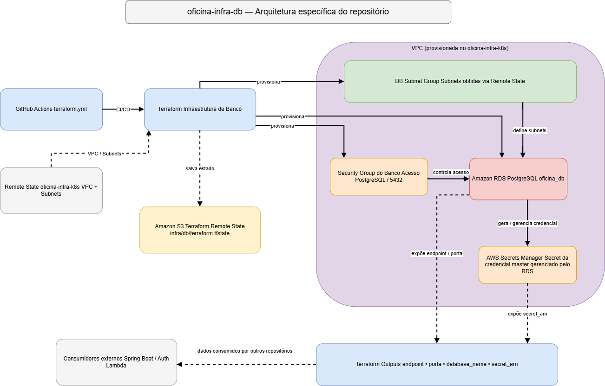

# Oficina Dinoco - Infraestrutura de Banco de Dados

Repositório responsável pelo provisionamento da infraestrutura de banco de dados da aplicação **Oficina Dinoco** na AWS utilizando Terraform.

## Responsabilidades

Este repositório provisiona:

- Amazon RDS
- PostgreSQL
- DB Subnet Group
- Security Group do banco
- Integração com AWS Secrets Manager para a senha do usuário master

A infraestrutura de rede e Kubernetes é provisionada separadamente no repositório `oficina-infra-k8s`.

## Tecnologias

- AWS
- Terraform
- Amazon RDS
- PostgreSQL
- AWS Secrets Manager
- GitHub Actions

## Arquitetura



## Estrutura

```text
.
├── .github/
│   └── workflows/
│       └── terraform.yaml
├── terraform/
│   ├── backend.tf
│   ├── database.tf
│   ├── locals.tf
│   ├── outputs.tf
│   ├── providers.tf
│   ├── remote-state.tf
│   └── variables.tf
├── .gitignore
└── README.md
```

## Dependência

Este repositório depende da infraestrutura criada pelo `oficina-infra-k8s`.

Os dados de VPC e Subnets são obtidos através do Terraform Remote State armazenado no S3.

Por isso, a infraestrutura Kubernetes deve ser provisionada antes do banco de dados.

## Execução local

Configure o profile AWS se necessário :

```powershell
$env:AWS_PROFILE="profile"
```

Acesse a pasta Terraform:

```bash
cd terraform
```

Inicialize o Terraform:

```bash
terraform init
```

Valide a configuração:

```bash
terraform validate
```

Visualize o plano:

```bash
terraform plan
```

Para provisionar manualmente:

```bash
terraform apply
```

> O deploy oficial deve ocorrer através da pipeline de CI/CD.

## Terraform State

O estado remoto deste projeto é armazenado no Amazon S3:

```text
Bucket: oficina-state-priess952
Key: infra/db/terraform.tfstate
Region: us-east-1
```

## Segurança

A senha do usuário master do PostgreSQL é gerenciada pelo próprio Amazon RDS através do AWS Secrets Manager.

Nenhuma senha do banco deve ser armazenada diretamente no código, em arquivos `.tfvars` versionados ou em arquivos de state locais.

## CI/CD

A pipeline GitHub Actions está localizada em:

```text
.github/workflows/terraform.yaml
```

### Pull Request para `main`

Executa:

```text
terraform fmt
terraform init
terraform validate
terraform plan
```

### Merge/Push na `main`

Executa as validações e:

```text
terraform apply -auto-approve
```

realizando automaticamente o deploy da infraestrutura de banco na AWS.

## Bancos de aplicação

O job de bootstrap prepara três bancos lógicos na mesma instância RDS. Cada usuário possui permissões no próprio banco para executar as migrations do serviço.

| Serviço | Banco | Usuário | Secret no Kubernetes |
| --- | --- | --- | --- |
| Núcleo | `oficina_db` | `nucleo_app` | `nucleo-database-secret` |
| Catálogo de produtos | `oficina_produtos_db` | `catalogo_produto_app` | `catalogo-produto-database-secret` |
| Financeiro | `oficina_financeiro_db` | `financeiro_app` | `financeiro-database-secret` |

O workflow usa os GitHub Repository Secrets `NUCLEO_DB_PASSWORD`, `CATALOGO_DB_PASSWORD` e `FINANCEIRO_DB_PASSWORD`. As senhas devem ser diferentes e ter pelo menos 16 caracteres. O bootstrap verifica as credenciais já publicadas no cluster antes de executar o job e rejeita divergências, para que a rotação siga um procedimento separado.

O job testa autenticação, criação de objetos e isolamento entre os bancos antes de publicar as credenciais. O Secret de cada serviço contém `SPRING_DATASOURCE_URL`, `SPRING_DATASOURCE_USERNAME` e `SPRING_DATASOURCE_PASSWORD`. A URL JDBC exige SSL. As migrations do financeiro são aplicadas pelo Flyway da aplicação.

Para verificar a publicação do Secret financeiro no namespace padrão:

```bash
kubectl -n default get secret financeiro-database-secret
```

## Outputs

Este projeto disponibiliza:

- Endpoint do PostgreSQL
- Porta do banco
- Nome do banco
- ARN do Secret gerenciado pelo RDS
